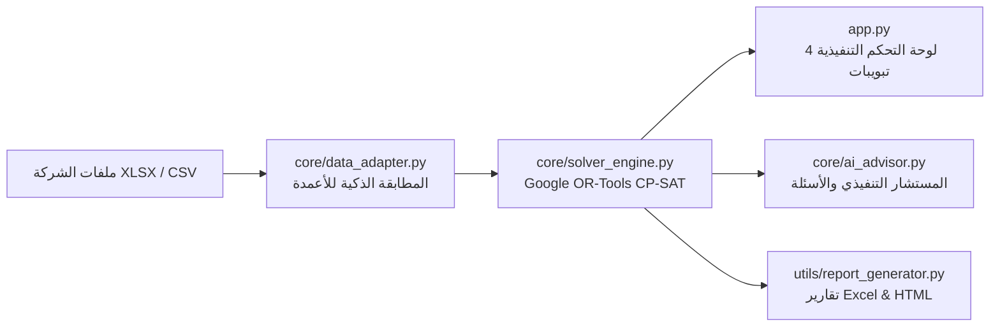

# ⚡ قرار | Qarar AI
**منصة دعم القرار وجدولة العمليات الذكية (Enterprise Plug & Play Decision Platform)**

---

## المعمارية الهندسية | System Architecture

---

## المميزات الرئيسية | Key Features
1. **مركز البيانات والربط الذكي:** دعم `.xlsx` و `.csv` مع مطابقة ذكية للأعمدة (عربي/إنجليزي) و 3 قوالب قطاعات جاهزة.
2. **غرفة العمليات والخطة المثلى:** تحسين متعدد الأهداف (أسرع تسليم / أقل تكلفة / توازن ذكي)، مخطط جانت، وكاشف الاختناقات.
3. **محاكي السيناريوهات (What-If):** محاكاة زيادة الطلب، الأعطال، الساعات الإضافية، وعجز المخزون مع مقارنة فورية.
4. **التنبؤ المالي والتقارير:** تحليل هيكل التكاليف، حساب الوفر (ROI)، وتصدير تقارير Excel و HTML.

---

## النشر السحابي | Streamlit Community Cloud
1. ادفع الكود إلى مستودع GitHub (`https://github.com/darshstudio2026/Qarar.git`).
2. افتح [share.streamlit.io](https://share.streamlit.io) واختر المستودع والفرع `main` والملف `app.py`.
3. اضغط **Deploy**.
